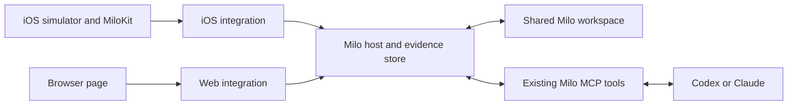

# Milo iOS and web support proposal

Status: proposed, not implemented. Updated November 17, 2026. Source baseline: Milo `c5fc11e`.

Milo should have one workspace, annotation store, and agent interface, with separate integrations for iOS simulators and browser pages. The shared experience is selecting something, explaining a change, attaching trustworthy evidence, and reviewing the agent's response. Platform integrations supply that evidence and declare which operations they support.

**Recommendation: start with a Chrome extension connected to the existing Milo host.** Annotate directly in the app's browser tab, using a small picker and comment box. Keep the feedback queue, conversations, history, and agent responses in Milo. This preserves normal browser interaction and existing logins while giving both platforms the same feedback workflow.

The initial experience would use existing browser tabs. If a later version needs to show the live web app inside Milo's main canvas, a managed Chromium session through the Chrome DevTools Protocol (CDP) could provide that integration. The shared contract below supports either route; the first milestone needs only the extension.

The first implementation should retain the Swift host and Svelte workspace. Adding web support does not require an Electron rewrite, a new backend, or replacing the existing iOS capture pipeline. Web support would initially run on macOS; supporting web apps does not by itself make Milo available on Windows or Linux.

## Current architecture and extraction points

| Owning source | Current behavior | Required change |
| --- | --- | --- |
| `app/host/Sources/milo/Store.swift` | Stores arbitrary JSON records, statuses, replies, and agent ownership; preserves unknown fields | Retain lifecycle; add scoped queries and versioned normalization |
| `app/host/Sources/milo/Server.swift` | Annotation creation requires `udid`, does AX hit testing, constructs a device record, and requires screenshots | Separate iOS evidence construction from common annotation validation and storage |
| `app/host/Sources/milo/Format.swift` | Exports device context and measurements in points | Format platform context and units explicitly |
| `app/host/Sources/milo/MCP.swift` | Seven lifecycle tools; prompts assume SwiftUI/UIKit | Keep names and semantics; add optional project/session filters and platform-aware instructions |
| `app/web/src/lib/app.svelte.js` | Global simulator state controls capture, selections, review, and submission | Extract active-surface state, evidence capture, selection state, and annotation submission |
| `app/web/src/lib/measure.js` | Reusable rectangle algorithms mixed with AX/MiloKit candidates, point units, and rotation handling | Separate geometry from platform candidate collection and coordinate conversion |
| `app/web/src/lib/review.js` | Stores sampled image frames with arrival timestamps | Accept source timestamps and capture dimensions; retain bounded memory |
| `Sources/MiloKit/` | Optional native view/source enrichment | Preserve; use optional web instrumentation for a comparable enrichment role |

The existing `annotation.target` means the selected element. Do not reuse that name for the browser or simulator session. Unknown-field preservation in Store does not mean Server accepts new fields: creation currently constructs a specific record shape.

## Shared architecture

Use a small integration contract for connection, capabilities, screenshot capture, element inspection, and disconnection. Streaming, input forwarding, recording, and animation controls are optional capabilities. Keep the page overlay limited to a hover outline, element/text/area selection, multi-select, and a comment input. Use scoped styles or shadow DOM, and test focus handling and stacking; style isolation alone cannot guarantee compatibility with every app.

The shared annotation envelope should carry:

- A schema version, ID, comment, status, replies, and timestamps.
- A project ID, session ID, and `surface` identifying the simulator or browser document. Project identity comes from explicit connection setup, not guessed from a URL.
- A capture ID, capture time, viewport dimensions, coordinate space, units, and screenshot dimensions. Browser evidence also records document identity, navigation revision, scroll offsets, device pixel ratio, and viewport scale.
- Selection kind and parts, with source-specific evidence: iOS AX/MiloKit context or web DOM selectors, selected text, bounded computed styles, and optional component/source metadata.
- Screenshot and crop references, measurements with provenance, and optional recording/frame timestamps.

Store exact file locations only when instrumentation supplies them. A CSS selector or component name is a search hint, not proof of a source file and line. Historical frames must not inherit metadata from the current live document.

Normalize old records as iOS annotations when reading them, preserve their IDs and lifecycle, and keep legacy API requests working. New connections carry project/session scope; legacy records can remain in a default legacy scope. A project-management UI is unnecessary for the first slice. Keep these review-session IDs distinct from MCP agent ownership IDs. Preserve existing MCP behavior for unscoped callers while making filters available to new callers. A browser connection should receive access only to its own session; it should not gain simulator-management access.

## Browser delivery choices

| Approach | Main advantage | Main cost | Recommended role |
| --- | --- | --- | --- |
| Milo-managed Chromium through CDP | Web can use Milo's existing central canvas and capture workflow | Separate login profile, streamed interaction, input and capture fidelity work | First candidate when one-window interaction is central |
| Browser extension with an in-page overlay | Works in existing tabs with existing logins and normal browser interaction | Another UI surface, extension lifecycle and permissions, separate recording path | First candidate when existing tabs are central |
| Development SDK inside the app | Direct DOM access and optional component/source instrumentation | Per-project installation; screenshot capture still needs a browser capability or explicit screen-sharing permission | Optional enrichment, or a deliberately limited annotation-only mode |
| iframe in Milo | Small demo for controlled pages | Embedding policies and cross-origin access prevent general support | Controlled previews only |
| Electron or native webview shell | Can host real web content in an application window | Packaging, browser integration, and a larger product rewrite | Reconsider only after validating the workflow |

An extension can use browser screenshots; an ordinary page script cannot assume equivalent access. Avoid treating DOM-to-canvas reconstruction as authoritative pixels. Chrome's `captureVisibleTab` is limited to two calls per second; animation recording needs a separate mechanism such as user-initiated `tabCapture`. [Chrome tabs API](https://developer.chrome.com/docs/extensions/reference/api/tabs), [tab capture API](https://developer.chrome.com/docs/extensions/reference/api/tabCapture).

For a managed browser, use a dedicated persistent development profile. Chrome's remote-debugging command-line switches require a non-default data directory from Chrome 136 onward. Prefer a child-process pipe when practical to avoid exposing a debugging TCP listener. New explicit-user remote-debugging attachment flows are a separate product option, not permission to silently attach to everyday tabs. [Chrome remote debugging changes](https://developer.chrome.com/blog/remote-debugging-port), [Playwright browser connection documentation](https://playwright.dev/docs/api/class-browsertype).

CDP exposes screenshots, screencast frames, and frame metadata. Its screencast API is experimental; benchmark it on supported Chromium versions before promising smooth playback. Preserve frame swap timestamps where available and clearly distinguish sampled review from a deterministic animation timeline. [CDP protocol definitions](https://github.com/ChromeDevTools/devtools-protocol/blob/master/json/browser_protocol.json).

An iframe is unsuitable as the general solution because pages can prohibit embedding, and cross-origin DOM access needs a cooperating bridge. Do not weaken an app's security headers to make the product appear to work. [CSP frame ancestors](https://developer.mozilla.org/en-US/docs/Web/HTTP/Reference/Headers/Content-Security-Policy/frame-ancestors).

## Functional parity

| User task | iOS | Web proposal |
| --- | --- | --- |
| Click, box, or multiple selections | AX/MiloKit or image regions | DOM elements or image regions; text ranges for copy feedback |
| Screenshot and crop | Simulator capture | Browser capture with document and viewport identity |
| Measure size and gaps | Reported native bounds in points | Reported DOM bounds in CSS pixels |
| Inspect layout properties | Native metadata where reported | Selected computed styles; separate CSS padding/gap from measured visual distance |
| Find source | Optional MiloKit tags | Optional development instrumentation; selectors/text remain fallback hints |
| Freeze for annotation | Hold a captured image | Hold a captured image; optional supported animation pause |
| Review motion | Captured frames | Captured frames with recorded timestamps and dropped-frame limitations |
| Send, acknowledge, reply, resolve | Existing Milo lifecycle | Same lifecycle and tools |

Do not infer CSS padding from a visual gap or merge CSS pixels with iOS points. Transforms, clipping, nested scrollers, sticky elements, shadow roots, and frames require explicit handling. Begin with top-level documents and degrade unsupported content to image-region annotations.

Browser animation pause should distinguish CSS/Web Animations from JavaScript loops, canvas, WebGL, and Rive. `getAnimations()` exposes CSS animations, transitions, and Web Animations; it does not provide universal execution pause. Preserve and restore each animation's prior state. Recorded frame review remains the broad fallback. [Web animation API](https://developer.mozilla.org/en-US/docs/Web/API/Document/getAnimations).

## Capture integrity and connection boundaries

A screenshot and a separately collected DOM tree are not automatically an atomic snapshot. Associate both with a capture transaction, verify document and viewport identity before and after capture, and detect observable mutations. If the page changes, retry or retain image-only evidence. Timestamps and checks reduce mismatches but cannot guarantee synchronization with every compositor animation.

For an extension, collect DOM evidence in an isolated content script and keep the host credential in the extension worker. Use a narrowly defined main-world bridge only for optional framework metadata. Pair the extension with the local host, authenticate requests, restrict endpoints, and validate message senders and document/session identity. Preserve Milo's existing Host and Origin protections; do not replace them with wildcard CORS. [Chrome content scripts](https://developer.chrome.com/docs/extensions/develop/concepts/content-scripts).

Capture only selected, bounded context. Exclude password values and avoid collecting cookies, storage, authorization headers, or arbitrary form values. Screenshots may still contain visible sensitive information, so the user must be able to preview the evidence being sent.

## Agentation compatibility

Agentation demonstrates the useful interaction pattern: select an element or region, add feedback, and give the agent concrete context. Its current MCP workflow also supports sessions, replies, and resolution. Milo already owns a similar lifecycle, so a second annotation backend is unnecessary. [Benji Taylor's introduction](https://benji.org/agentation), [Agentation MCP](https://www.agentation.com/mcp).

Implement Milo's web integration independently. Agentation's published terms allow internal use and request commercial licensing for redistribution in a sold product; inspect the exact package license before embedding its implementation. [Agentation licensing](https://www.agentation.com/).

Consider Agentation AFS import/export later. Its required element path/tag and mixed browser coordinate conventions do not make it an appropriate native iOS internal schema. An adapter can preserve shared lifecycle fields while documenting lossy conversions. [Agentation schema](https://www.agentation.com/schema).

## Implementation sequence and acceptance gates

1. **Establish the shared contract.** Add versioned annotations, surfaces, capabilities, units, and project/session scope. Extract the smallest parts of global UI state needed for a second surface. Gate: existing saved iOS annotations render unchanged, existing MCP names work, and current annotation, measurement, and review checks pass.
2. **Prove one browser annotation end to end.** Open one local page, select an element, capture actual pixels plus context, submit through the same store, and acknowledge/reply/resolve from an agent. Gate: screenshot, crop, element bounds, project, and page identity agree; an iOS annotation can coexist without crossover.
3. **Test the chosen interaction surface.** For managed Chromium, test typing, scrolling, clipboard, IME, file inputs, dialogs, popups, and viewport changes. For an extension, test active-tab capture, switching tabs during capture, worker restart, reload/reconnect, and app styles that could collide with its overlay. Gate: unsupported interactions are visible and recoverable; notes survive reconnect without duplicates.
4. **Add selection and measurement depth.** Text ranges, multi-select, area selection, DOM bounds, selected computed styles, and optional source enrichment. Gate: known geometry fixtures remain accurate across scroll, zoom, and device pixel ratio; inaccessible frames and opaque content degrade honestly.
5. **Add motion review.** Capture source timestamps, bounded frame storage, playback, scrubbing, and frame annotations. Gate: historical frames carry no live DOM claims, capture limits work, and measured frame delivery is sufficient for the user's real animations.

Use Milo's existing `app/scripts/check_mcp.py`, `app/web/src/lib/measure.test.js`, and `app/web/src/lib/review.test.js` as regression anchors. Add browser fixtures for navigation during capture, transformed elements, nested scrolling, canvas, and multiple sessions. Assess capture latency and visual alignment on representative apps before committing to a performance promise or schedule.

The first release should exclude universal browser support, Windows/Linux hosting, arbitrary closed-shadow or cross-origin inspection, production source mapping, and a universal animation debugger. Those are separate capabilities, not prerequisites for a useful shared annotation workflow.

## First prototype

Build the shared contract and one unpacked Chrome extension that can submit an element or area annotation from a local app. Include a real screenshot and crop, URL, title, selector, DOM bounds, viewport metadata, and a small set of computed styles. Verify the full acknowledge, reply, and resolve cycle through Milo's existing MCP tools while an iOS annotation remains independently accessible.

Keep project/session metadata in new connections, with a default scope for legacy records, to prevent feedback from reaching the wrong app. A project-management interface can wait.

Before expanding the prototype, measure screenshot/DOM alignment during scrolling and navigation, verify that the overlay is absent from captures, and exercise reconnection without duplicate notes. Source mapping and animation capture require separate validation; neither is a prerequisite for this first round trip.
